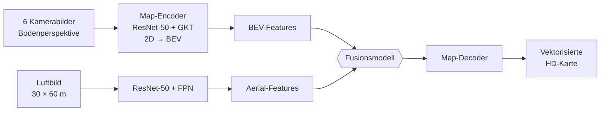
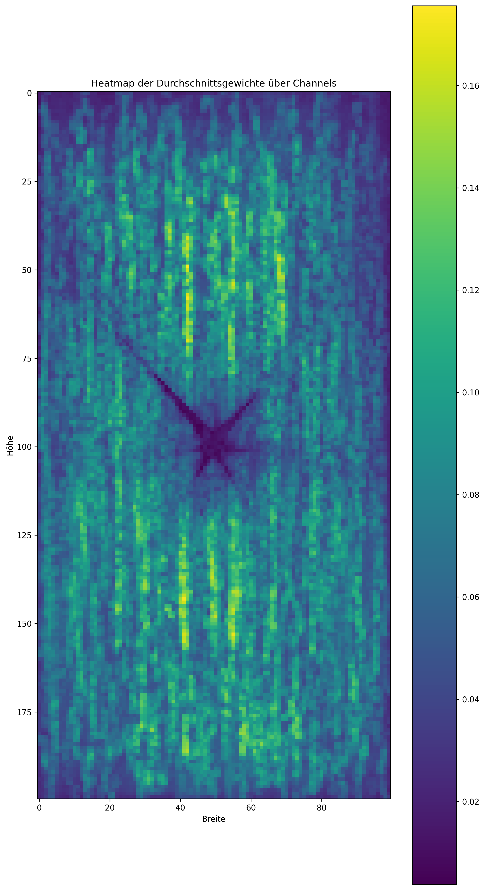
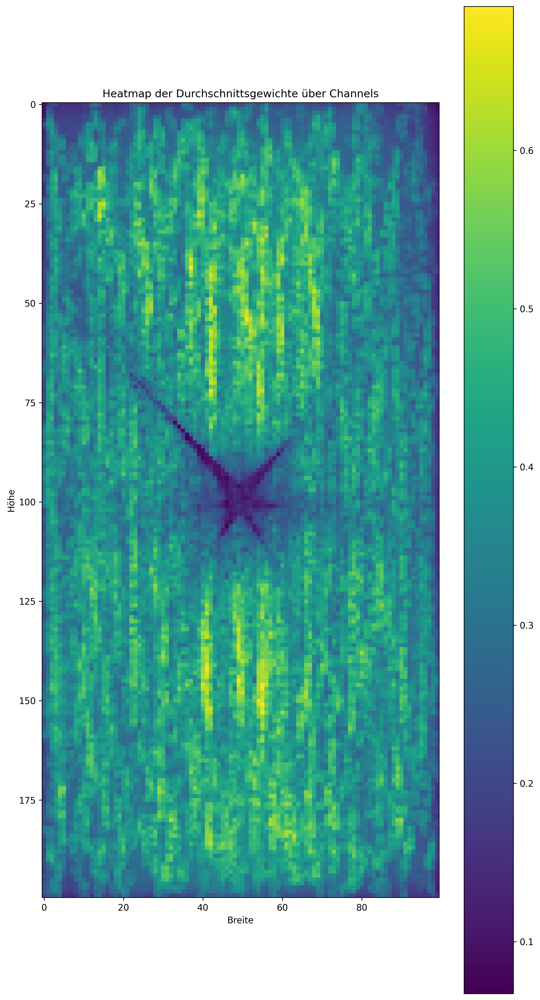

# Transformerbasierte Fusion von Luft- und Bodensensordaten zur Erstellung von HD-Kartenmaterial

**Bachelorarbeit** von Adrian Noah Wimmer
Karlsruher Institut für Technologie (KIT), Fakultät für Wirtschaftswissenschaften, Institut AIFB,
in Kooperation mit dem FZI Forschungszentrum Informatik (Abteilung Technisch kognitive Systeme)

| | |
|---|---|
| Bearbeitungszeit | 10.07.2024 – 10.01.2025 (Abgabe Januar 2025) |
| Erstgutachter | Prof. Dr. J. Marius Zöllner |
| Zweitgutachter | Prof. Dr. Andreas Oberweis |
| Betreuung | Rupert Polley, M.Sc. |
| Arbeit (PDF) | [`docs/thesis/Bachelorarbeit_Wimmer_2025.pdf`](docs/thesis/Bachelorarbeit_Wimmer_2025.pdf) |
| Code-Stand der Abgabe | Tag [`bachelorarbeit-abgabe`](https://github.com/adriannoahwimmer/maptr-aerial-fusion/tree/bachelorarbeit-abgabe) |

> **English summary.** This repository extends [MapTR](https://github.com/hustvl/MapTR), an online
> vectorized HD map construction network that uses six vehicle cameras, with a second branch for
> **aerial images**. Aerial features (ResNet-50 + FPN) are fused with MapTR's bird's-eye-view (BEV)
> features by static and dynamic fusion modules. On nuScenes, the best model (a learned static weight
> tensor with feature scaling, initialized from a trained MapTR baseline) improves the mAP of the
> MapTR-tiny baseline from 0.4703 to 0.4841. The thesis is written in German.

## Kurzfassung

Die Arbeit beschäftigt sich mit der Konzeption, Umsetzung und Evaluation einer transformerbasierten
Netzwerkarchitektur, die Luftbilder und Kamerabilder aus Bodenperspektive eines Fahrzeugs fusioniert
und daraus online eine HD-Karte der Umgebung erzeugt. Im Fokus steht die Erweiterung der existierenden
MapTR-Architektur um ein Fusionsmodell. Es wurden statische und dynamische Fusionsmodelle konzipiert und
implementiert; dabei konnte die Genauigkeit der MapTR-Baseline übertroffen werden. Am besten schneiden
Modelle ab, die **Feature Scaling** verwenden und auf einer **vortrainierten** MapTR-Architektur aufbauen.

## Architektur



Die Aerial-Features werden auf das BEV-Raster (200 × 100) interpoliert und im Fusionsmodell mit den
BEV-Features kombiniert. Danach läuft die unveränderte MapTR-Pipeline (Decoder, Matching, Loss).

### Fusionsmodelle

Beim **Feature Scaling (FS: BCWH)** werden die Aerial-Features über Batch, Channel, Width und Height auf
Mittelwert und Standardabweichung der BEV-Features gebracht.

| Modell in der Arbeit | Klasse | Config |
|---|---|---|
| GD: CWH pre-trained Xavier FS: BCWH (statisch, **bestes Modell**) | `CWLFuser` | [`maptr_tiny_r50_24e_aerial_cwl.py`](projects/configs/maptr_aerial/maptr_tiny_r50_24e_aerial_cwl.py) |
| Dynamic Summed Fusion pre-trained FS: BCWH | `DynamicWeightSumFuser` | [`maptr_tiny_r50_24e_aerial_dynsum.py`](projects/configs/maptr_aerial/maptr_tiny_r50_24e_aerial_dynsum.py) |
| Dynamic Convolutional Fusion pre-trained FS: BCWH | `AdvancedDynamicConvFuser` | [`maptr_tiny_r50_24e_aerial_dynconv.py`](projects/configs/maptr_aerial/maptr_tiny_r50_24e_aerial_dynconv.py) |
| Concatenation Fusion non pre-trained | `ConvFuser` (aus MapTR) | [`maptr_tiny_r50_24e_aerial_concat.py`](projects/configs/maptr_aerial/maptr_tiny_r50_24e_aerial_concat.py) |

Die Fuser stehen in [`projects/mmdet3d_plugin/maptr/modules/transformer.py`](projects/mmdet3d_plugin/maptr/modules/transformer.py).

- **Statisch** (`CWLFuser`): `fused = w · BEV + (1 − w) · Aerial`, mit einem gelernten Gewichtstensor
  `w ∈ R^(C×W×H)` (Xavier-initialisiert), der zur Inferenz fest ist.
- **Dynamisch** (`DynamicWeightSumFuser`, `AdvancedDynamicConvFuser`): `w = σ(Conv3×3(BEV))` wird pro
  Eingabe aus den BEV-Features berechnet. Die gewichteten Features werden addiert bzw. mit einer
  weiteren Convolution kombiniert.
- **pre-trained** heißt: Die Gewichte kommen aus einem trainierten MapTR-tiny (nur Kameras). Trainiert
  werden nur Luftbild-Backbone, FPN und Fusionsmodell (`load_from_maptr` und `trainable_modules` in der Config).

## Ergebnisse

nuScenes-Validierungssplit, MapTR-tiny (R50, GKT), 24 Epochen, 1 × NVIDIA A100 80 GB (ca. 3,5 Tage pro
Lauf). Die mAP ist über die Klassen Fahrspurmarkierung, Fußgängerüberweg und Straßengrenze sowie über die
Chamfer-Schwellen 0,5 / 1,0 / 1,5 m gemittelt (wie bei MapTR). Angegeben ist die beste Epoche. Abgebrochene
Läufe sind markiert.

| Modell | Typ | mAP | Epoche |
|---|---|---:|---:|
| MapTR-tiny Baseline (eigenes Training) | – | 0.4703 | 22 |
| **GD: CWH pre-trained Xavier FS: BCWH** | statisch | **0.4841** | 22 |
| Dynamic Convolutional Fusion pre-trained FS: BCWH | dynamisch | 0.4735 | 20 |
| Dynamic Summed Fusion pre-trained FS: BCWH | dynamisch | 0.4723 | 16 |
| GD: CWH pre-trained Xavier FS: BWH | statisch | 0.4594 | 22 |
| Concatenation Fusion non pre-trained | dynamisch | 0.2366 | 24 |
| GD: C non pre-trained 0.5 | statisch | 0.2320 | 22 |
| GD: CWH pre-trained Xavier (ohne FS) | statisch | 0.1059 | 10 (abgebrochen) |
| GD: CWH non pre-trained Xavier | statisch | 0.0958 | 6 (abgebrochen) |

Das beste Modell liegt 2,9 % (relativ) über der Baseline. In der qualitativen Analyse (Kapitel 6.3.1) sieht
man, dass das Netz mit Luftbildern Fahrspuren und Kreuzungen erkennt, die in den Kamerabildern verdeckt
sind. Umgekehrt verdecken Bäume und Gebäude Teile der Luftbilder.

<p align="center">
  
  
</p>
<p align="center"><sub>Gelernter Gewichtstensor eines <code>CWLFuser</code> nach Epoche 1 und 24, gemittelt über die
Channels (Anteil der BEV-Features, 0 = nur Luftbild). An den Rändern und zwischen den Kamerasichtfeldern
nutzt das Netz mehr Luftbild-Features.</sub></p>

## Installation und Nutzung

Der Code baut auf [MapTR](https://github.com/hustvl/MapTR) (Commit `fa420a2`, Mai 2024) auf. Installation
und Datenvorbereitung laufen wie bei MapTR:

1. **Umgebung**: siehe [`docs/install.md`](docs/install.md). Die Versionen der Umgebung aus der Arbeit
   stehen zusätzlich in [`requirement_2.txt`](requirement_2.txt).
2. **nuScenes vorbereiten**: siehe [`docs/prepare_dataset.md`](docs/prepare_dataset.md). Die Info-Dateien
   müssen mit diesem Repo erzeugt werden, weil sie zusätzlich den `scene_name` enthalten:
   ```bash
   python tools/create_data.py nuscenes --root-path ./data/nuscenes --out-dir ./data/nuscenes \
       --extra-tag nuscenes --version v1.0 --canbus ./data
   ```
   Optional lässt sich ein eigener Split angeben: `--custom_split --trainsplit splits/train-v1.txt --valsplit splits/val-v1.txt`.
3. **Luftbilder** (nicht enthalten, siehe unten) als PNG je Sample ablegen:
   ```
   data/nuscenes/aerial/30x60m/<scene_name>/aerial_<sample_token>.png
   ```
   Jedes Bild deckt 30 × 60 m um das Fahrzeug ab, Fahrtrichtung nach oben. Der Loader skaliert es auf
   202 × 404 Pixel (`aerial_img_size` in `LoadMultiViewImageFromFiles`).
4. **Checkpoints** nach `ckpts/`:
   - `resnet50-19c8e357.pth` (ImageNet, wie bei MapTR)
   - `panoptic_fpn_r50_fpn_mstrain_3x_coco_20210824_171155-5650f98b.pth` (Luftbild-Backbone, aus dem
     [MMDetection Model Zoo](https://github.com/open-mmlab/mmdetection/tree/v2.28.2/configs/panoptic_fpn))
   - `maptr_tiny_r50_24e.pth`: trainierte MapTR-tiny-Baseline für die pre-trained-Varianten (z. B. der
     Checkpoint aus dem MapTR-README). In der Arbeit wurde eine selbst trainierte Baseline mit
     Gradientenakkumulation verwendet.
5. **Training und Evaluation** (Beispiel mit 1 GPU):
   ```bash
   ./tools/dist_train.sh projects/configs/maptr_aerial/maptr_tiny_r50_24e_aerial_cwl.py 1
   ./tools/dist_test_map.sh projects/configs/maptr_aerial/maptr_tiny_r50_24e_aerial_cwl.py \
       work_dirs/maptr_tiny_r50_24e_aerial_cwl/epoch_24.pth 1
   ```
   Effektive Batch-Größe 32: Mini-Batch 4 × 8 akkumulierte Iterationen. Tensorboard-Logs (inkl. Bildern
   von Kameras, Luftbild und Prädiktion) landen in `work_dirs/<config>/tf_logs/`.
6. **Auswertung**:
   - [`tools/aerial_fusion/visualize_fusion_weights.py`](tools/aerial_fusion/visualize_fusion_weights.py): Heatmap des gelernten Gewichtstensors
   - [`tools/aerial_fusion/visualize_checkpoints.py`](tools/aerial_fusion/visualize_checkpoints.py): Prädiktionen mehrerer Epochen und Schwellen visualisieren
   - [`tools/aerial_fusion/subset_infos.py`](tools/aerial_fusion/subset_infos.py): Info-Datei mit ausgewählten Szenen erstellen
   - [`tools/aerial_fusion/strip_info_paths.py`](tools/aerial_fusion/strip_info_paths.py): Datenpfade in Info-Dateien umschreiben

Ohne `aerialimg_backbone` und `aerial_fuser` in der Config verhält sich der Code wie das ursprüngliche
MapTR. Die Original-Configs unter `projects/configs/maptr/` funktionieren also weiterhin.

### Daten und Luftbilder

- **nuScenes** wird nicht mitgeliefert ([Lizenz](https://www.nuscenes.org/terms-of-use)). Abgeleitete
  Dateien wie die Kartenannotationen (`nuscenes_map_anns_val.json`) erzeugt MapTR bei der ersten Evaluation selbst.
- Die **Luftbilder** stammen aus der Satellitenansicht von Apple Maps (Zoomstufe 19). Sie wurden mit
  einem angepassten Skript auf Basis von [jimutmap](https://github.com/Jimut123/jimutmap) als Kacheln
  geladen, den nuScenes-Samples zugeordnet, in Fahrtrichtung gedreht und für Boston und Singapur auf
  dieselbe Auflösung gebracht (Kapitel 5.6.2). Wegen der Nutzungsbedingungen von Apple sind weder die
  Bilder noch das Download-Skript Teil dieses Repos.

## Änderungen gegenüber MapTR

| Datei | Änderung |
|---|---|
| `projects/mmdet3d_plugin/maptr/modules/transformer.py` | Fusionsmodelle, optionales `aerial_fuser` im `MapTRPerceptionTransformer` |
| `projects/mmdet3d_plugin/maptr/detectors/maptr.py` | Luftbild-Zweig (Backbone, FPN, Zusammenführung der FPN-Ebenen), Bild-Logging |
| `projects/mmdet3d_plugin/maptr/dense_heads/maptr_head.py` | reicht `aerial_feats` an den Transformer weiter |
| `mmdetection3d/mmdet3d/models/detectors/mvx_two_stage.py` | baut `aerialimg_backbone` / `aerialimg_neck` |
| `mmdetection3d/mmdet3d/datasets/pipelines/loading.py`, `formating.py` | lädt und formatiert das Luftbild |
| `projects/mmdet3d_plugin/datasets/nuscenes_map_dataset.py` | Pfad zum Luftbild je Sample (`aerialdata_root`) |
| `tools/create_data.py`, `tools/data_converter/nuscenes_converter.py` | `scene_name` in den Info-Dateien, eigener Split |
| `tools/train.py` | `load_from_maptr` und `trainable_modules` für die pre-trained-Varianten |
| `projects/mmdet3d_plugin/core/logger_hooks/`, `.../bevformer/apis/mmdet_train.py`, `.../core/evaluation/eval_hooks.py` | Tensorboard-Logger mit Bildern |
| `projects/configs/maptr_aerial/` | Configs der Experimente |
| `tools/aerial_fusion/` | Auswertungsskripte |

Den vollständigen Diff zeigt `git diff fa420a2`.

### Stand der Abgabe und aufbereitete Version

Der Tag `bachelorarbeit-abgabe` enthält den Code so, wie er für die Arbeit verwendet wurde. Nur die aus
nuScenes abgeleitete Datei `nuscenes_map_anns_val-original.json` fehlt aus Lizenzgründen. Der aktuelle
Stand ist für die Veröffentlichung aufbereitet:

- Der Fuser wird in der Config gewählt statt im Code festgelegt.
- Checkpoint-Pfad und Freeze-Logik kommen aus der Config (`load_from_maptr`, `trainable_modules`) statt
  aus festen Cluster-Pfaden.
- Ohne Luftbild-Konfiguration verhält sich der Code wieder wie MapTR. Das betrifft unter anderem
  `ConvFuser`, die Signatur von `MVXTwoStageDetector` (wichtig für BEVFormer) und die Test-Schnittstelle.
- Debug-Ausgaben, auskommentierte Experimente und ein ungenutzter Attention-Ansatz für die Luftbilder
  wurden entfernt.

Die aufbereitete Version wurde **nicht erneut trainiert**. Die Ergebnisse oben stammen vom Stand der Abgabe.

### Bekannte Einschränkungen

- Der Luftbild-Backbone lädt den Panoptic-FPN-Checkpoint über `init_cfg` ohne `prefix`. Da die Schlüssel
  im Checkpoint mit `backbone.` bzw. `neck.` beginnen, hat mmcv die Gewichte vermutlich nicht übernommen.
  Dann starteten Backbone und FPN zufällig initialisiert (das lässt sich an den „missing keys“-Warnungen im
  Trainingslog prüfen). Für neue Experimente `prefix='backbone.'` bzw. `prefix='neck.'` ergänzen.
- `custom_keys={'img_backbone': dict(lr_mult=0.1)}` greift per Teilstring-Vergleich auch für
  `aerialimg_backbone`.
- In den pre-trained-Varianten bleiben die 1×1-Convolutions zum Zusammenführen der Luftbild-FPN-Ebenen
  (`lateral_convs`) eingefroren, wie in den Experimenten der Arbeit.
- Temporale Fusion (`queue_length > 1`) nutzt für vergangene Frames keine Luftbilder. `MapTR_fp16` ist
  nicht angepasst.
- Train- und Val-Split von MapTR/nuScenes überlappen räumlich. Das kann die Genauigkeit überschätzen
  (Kapitel 7).

## Danksagung

Der Code basiert auf [MapTR](https://github.com/hustvl/MapTR) (Liao et al., ICLR 2023), das wiederum auf
[BEVFormer](https://github.com/fundamentalvision/BEVFormer) und
[mmdetection3d](https://github.com/open-mmlab/mmdetection3d) aufbaut. Die ursprüngliche README von MapTR
steht in [`docs/MapTR_README.md`](docs/MapTR_README.md). Danke an Rupert Polley für die Betreuung am FZI.

## Zitieren

```bibtex
@thesis{wimmer2025luftbildfusion,
  author = {Wimmer, Adrian Noah},
  title  = {Transformerbasierte Fusion von Luft- und Bodensensordaten zur Erstellung von HD-Kartenmaterial},
  type   = {Bachelorarbeit},
  school = {Karlsruher Institut f{\"u}r Technologie (KIT)},
  year   = {2025},
  month  = jan
}

@inproceedings{MapTR,
  title     = {MapTR: Structured Modeling and Learning for Online Vectorized HD Map Construction},
  author    = {Liao, Bencheng and Chen, Shaoyu and Wang, Xinggang and Cheng, Tianheng and Zhang, Qian and Liu, Wenyu and Huang, Chang},
  booktitle = {International Conference on Learning Representations},
  year      = {2023}
}
```

## Lizenz

Der Code steht wie MapTR unter der [MIT-Lizenz](LICENSE). Die Bachelorarbeit selbst
(`docs/thesis/Bachelorarbeit_Wimmer_2025.pdf`) ist davon ausgenommen: © 2025 Adrian Noah Wimmer, alle Rechte
vorbehalten. Sie enthält Abbildungen aus nuScenes, Apple Maps und den zitierten Arbeiten. Die Quellen stehen
jeweils in der Arbeit.
